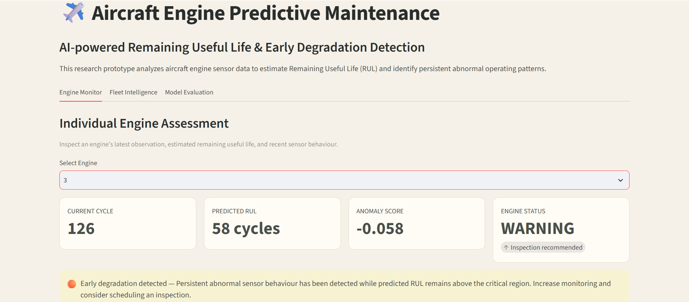
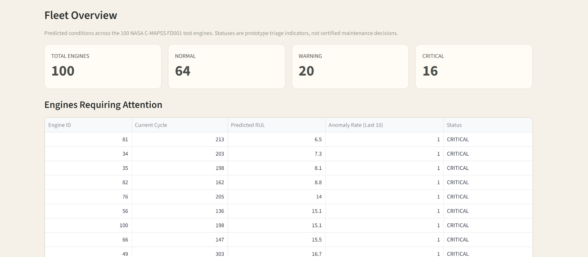
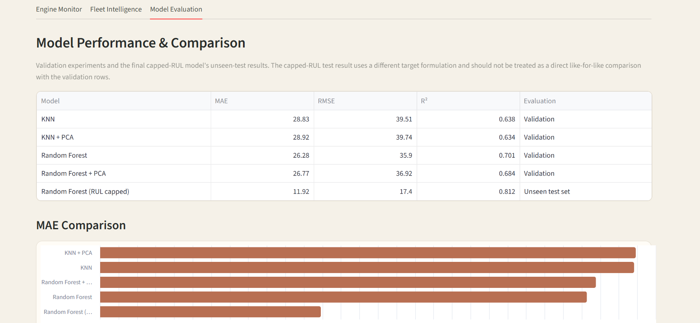

# Aircraft Engine Predictive Maintenance

An end-to-end machine learning project that predicts aircraft engine Remaining Useful Life (RUL), detects unusual sensor behaviour, and presents engine health insights through an interactive Streamlit dashboard.

## Overview

Unexpected engine degradation can lead to costly maintenance and operational disruptions. Predictive maintenance uses historical sensor data and machine learning to estimate remaining useful life and identify unusual operating patterns.

This project uses NASA's C-MAPSS FD001 simulated turbofan engine dataset to demonstrate how machine learning can support condition monitoring and maintenance planning.

### Objectives

- Predict engine Remaining Useful Life (RUL) using regression.
- Detect unusual sensor behaviour using anomaly detection.
- Visualize engine health and sensor trends.
- Monitor multiple engines through fleet-level summaries.
- Compare machine learning models using standard evaluation metrics.

## Features

### Engine Monitor
- Select an engine and inspect its latest observed cycle.
- View predicted Remaining Useful Life.
- Review engine status and anomaly indicators.
- Explore RUL trajectories and recent sensor behaviour.

### Fleet Intelligence
- Summarize engine statuses across the dataset.
- Identify engines that may require attention.
- Review fleet-level status distribution.

### Model Evaluation
- Compare Random Forest and KNN model variants.
- Evaluate predictions using MAE, RMSE, and R².
- Review model performance through tables and charts.

## Dataset

**NASA C-MAPSS — FD001**

The dataset contains simulated turbofan engine run-to-failure data, including operating cycles, operating settings, and 21 sensor measurements.

- Training data: `data/train_FD001.txt`
- Test data: `data/test_FD001.txt`
- Test-set RUL labels: `data/RUL_FD001.txt`

Dataset source: [NASA Prognostics Center of Excellence Data Repository](https://www.nasa.gov/intelligent-systems-division/discovery-and-systems-health/pcoe/pcoe-data-set-repository/)

The current implementation is configured specifically for FD001 and is not designed to accept arbitrary datasets without adaptation.

## Technologies Used

- **Python** — application and model development
- **Pandas and NumPy** — data processing
- **Scikit-learn** — machine learning and anomaly detection
- **Altair** — interactive data visualizations
- **Streamlit** — dashboard interface
- **Joblib / Pickle** — loading saved model artifacts
- **Jupyter Notebook** — exploratory data analysis

## Machine Learning Approach

### 1. Data preprocessing
Sensor measurements are examined and selected for modelling. Eleven useful sensor channels are used as model inputs.

### 2. Remaining Useful Life prediction
Random Forest Regression estimates the number of remaining operating cycles before the end of an engine's observed run-to-failure trajectory.

### 3. Anomaly detection
Isolation Forest identifies sensor patterns that differ from the learned reference behaviour.

### 4. Engine status assessment
Predicted RUL and anomaly indicators are combined using configurable prototype thresholds to assign Normal, Warning, or Critical statuses.

### 5. Evaluation
Random Forest and KNN variants are compared using Mean Absolute Error (MAE), Root Mean Squared Error (RMSE), and the coefficient of determination (R²).

## Model Evaluation Results

### Validation results

| Model | MAE (cycles) | RMSE (cycles) | R² |
|---|---:|---:|---:|
| Random Forest | 26.28 | 35.90 | 0.701 |
| KNN | 28.83 | 39.51 | 0.638 |
| Random Forest + PCA | 26.77 | 36.92 | 0.684 |
| KNN + PCA | 28.92 | 39.74 | 0.634 |

### Capped-RUL test evaluation

The capped-RUL Random Forest formulation achieved the following results on the held-out test set:

- **MAE:** 11.92 cycles
- **RMSE:** 17.40 cycles
- **R²:** 0.812

These test metrics use a capped RUL target and should not be directly compared with the uncapped validation results above. The uncapped test formulation produced MAE 24.80 cycles, RMSE 34.05 cycles, and R² 0.329.

## Project Structure

```text
aircraft-engine-predictive-maintenance/
├── app/
│   ├── app.py
│   └── app_backup.py
├── data/
│   ├── train_FD001.txt
│   ├── test_FD001.txt
│   └── RUL_FD001.txt
├── models/
│   ├── isolation_forest.pkl
│   ├── rf_rul_model.pkl
│   ├── scaler.pkl
│   └── useful_sensors.pkl
├── notebooks/
│   └── 01_data_exploration.ipynb
├── results/
├── src/
├── .gitignore
└── README.md
```

## Installation and Usage

### Prerequisites
- Python 3.10 or another version compatible with the project's dependencies
- Git
- A local copy of the required dataset and trained model artifacts

### 1. Clone the repository

```bash
git clone https://github.com/dheeptha07/aircraft-engine-predictive-maintenance.git
cd aircraft-engine-predictive-maintenance
```

### 2. Create and activate a virtual environment

On Windows PowerShell:

```powershell
python -m venv venv
.\venv\Scripts\Activate.ps1
```

### 3. Install dependencies

```bash
python -m pip install streamlit pandas numpy scikit-learn altair joblib
```

If the application uses additional packages, install those required by `app/app.py` as well.

### 4. Add the required model file

The trained Random Forest model, `models/rf_rul_model.pkl`, is approximately 179 MB and is excluded from this GitHub repository because it exceeds GitHub's standard 100 MB per-file limit.

To run the complete application, obtain the matching trained model artifact separately and place it at:

```text
models/rf_rul_model.pkl
```

The other model artifacts and dataset files are included in the repository.

### 5. Run the dashboard

From the project root:

```powershell
python -m streamlit run app/app.py
```

Open the local URL printed by Streamlit, usually `http://localhost:8501`.

## Dashboard Screenshots


## Dashboard Screenshots

### Engine Monitor


### Fleet Intelligence


### Model Evaluation



## Limitations

- Uses simulated NASA C-MAPSS FD001 data rather than live aircraft telemetry.
- FD001 represents a limited set of operating conditions and simulated fault behaviour.
- Engine status thresholds are prototype rules, not certified aviation maintenance limits.
- Predictions are estimates and do not include calibrated uncertainty.
- The application is an educational prototype, not a certified aircraft safety or maintenance system.

## Future Improvements

- Support additional compatible C-MAPSS subsets through adapted preprocessing and retraining.
- Improve model generalization and RUL estimation.
- Add prediction uncertainty and richer diagnostic explanations.
- Deploy the dashboard and make model artifacts easier to obtain.

## Author

**Dheeptha M.**

GitHub: [@dheeptha07](https://github.com/dheeptha07)

---

*Developed as a machine learning project demonstrating predictive maintenance, anomaly detection, model evaluation, and interactive data visualization.*